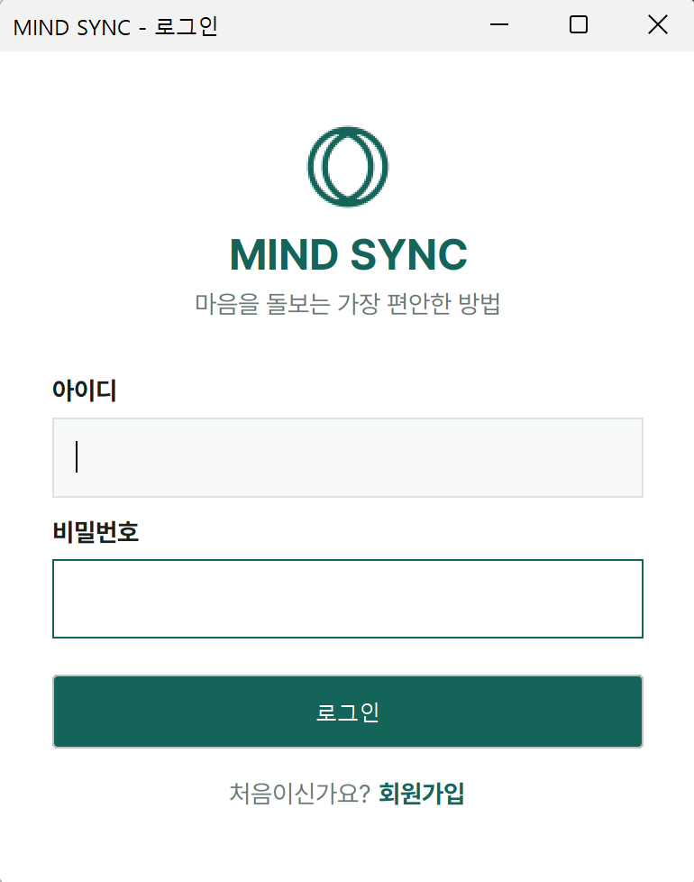
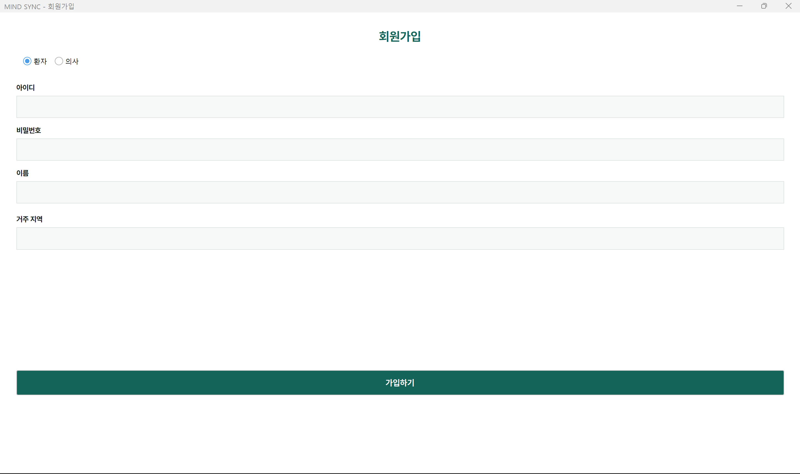
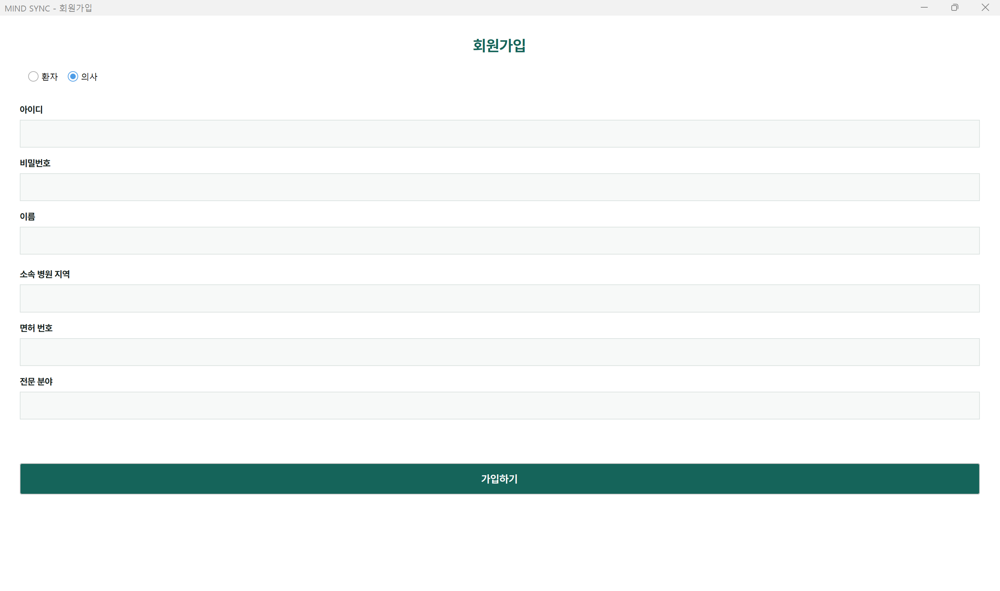
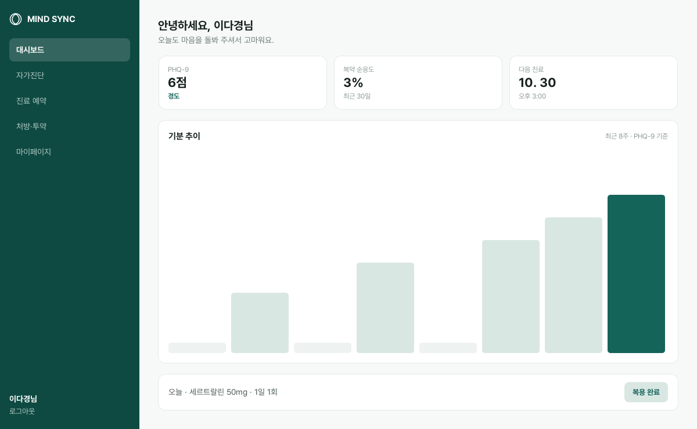
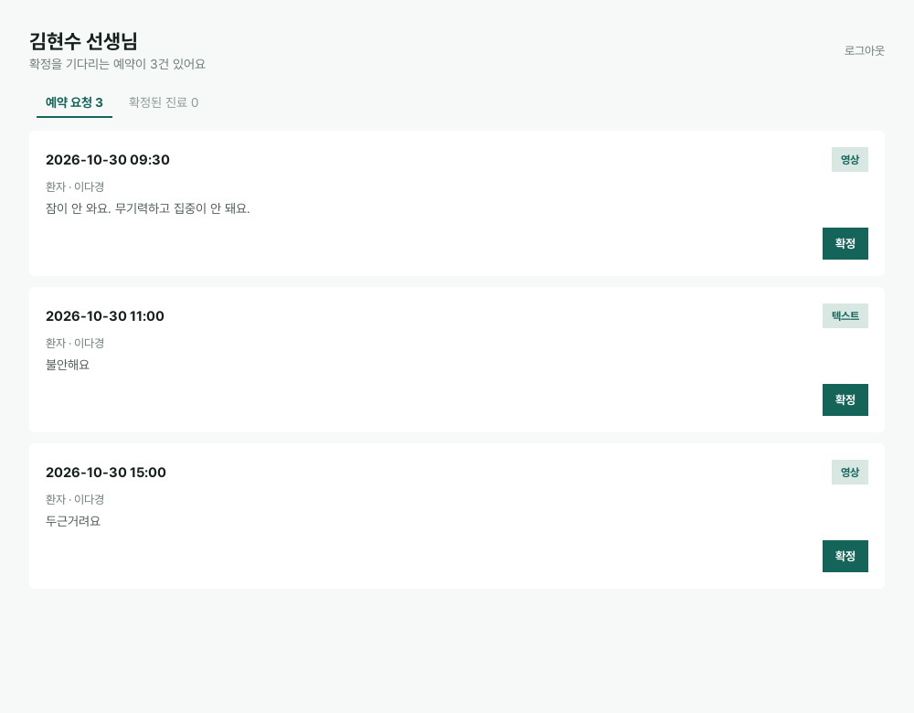
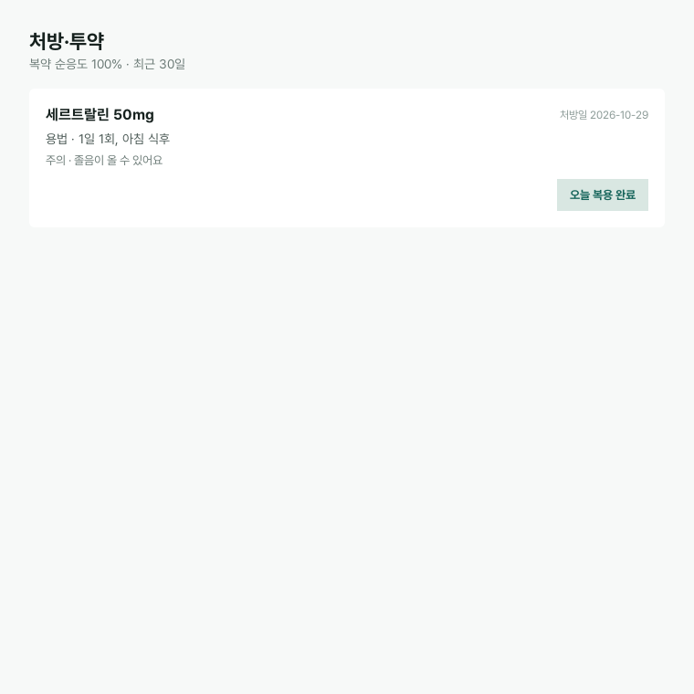
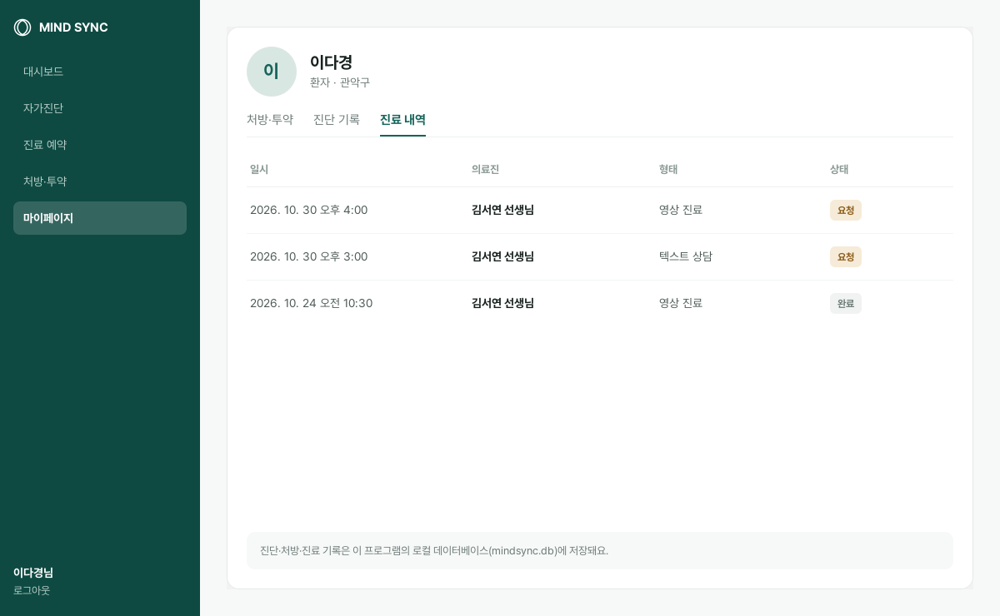

# MIND SYNC

정신건강 관리를 위한 Java 기반 데스크톱 애플리케이션입니다. 자가진단부터 비대면 진료, 처방·투약 기록, 커뮤니티까지 정신건강 관리의 전 과정을 하나의 프로그램에서 지원합니다.

## 소개

정신건강 문제는 초기에 발견하기 어렵고, 가족 환경이나 사회적 인식으로 인해 병원 방문 자체가 지연되거나 거부되는 경우가 많습니다. MIND SYNC는 이러한 진입장벽을 낮추기 위해, 검증된 자가진단부터 비대면 진료·처방, 투약 관리, 정서적 지지(커뮤니티)까지 이어지는 흐름을 하나의 프로그램으로 제공합니다.

## 주요 기능

- **자가진단**: 검증된 척도인 PHQ-9(우울 선별)로 자가진단을 실시하고 점수·해석을 제공하며, 결과는 대시보드에 반영됩니다.
- **비대면 진료**: 환자가 시간과 진료 방식(영상 진료 / 텍스트 상담)을 선택해 예약하면 거주 지역을 기준으로 의사가 자동 배정됩니다. 의사는 요청을 확인해 Zoom 링크와 함께 확정하고, 진료 상태(요청 → 확정 → 완료)는 환자의 마이페이지에서 확인할 수 있습니다.
- **처방 및 투약 기록**: 의사는 영상 진료에 한해 처방을 등록할 수 있고(텍스트 상담은 처방 불가), 환자는 처방받은 약을 확인하고 매일 복용 여부를 체크합니다. 체크 기록은 복약 순응도로 계산되어 대시보드에 표시됩니다.
- **마이페이지**: 내 정보와 진료 내역(상태, Zoom 링크)을 확인하고 로그아웃합니다.

### 향후 확장 (현재 미구현)
- GAD-7(불안 선별) 자가진단
- 커뮤니티: 글·댓글 모델과 DAO(`CommunityPost`, `CommunityComment`, `CommunityDAO`)는 만들어 두었으나 화면은 아직 연결하지 않았습니다.

## 기술 스택

| 구분 | 내용 |
|---|---|
| 언어 | Java (JDK 17) |
| GUI | Java Swing |
| 데이터베이스 | SQLite (JDBC) |
| 개발 도구 | IntelliJ IDEA |

## 프로젝트 구조

```
mindsync
 ├─ model   # User, Patient, Doctor 등 데이터 모델 (상속 구조 포함)
 ├─ db      # DatabaseManager - SQLite 연결 및 테이블 생성
 ├─ dao     # UserDAO, AppointmentDAO 등 - DB 조회/저장 로직
 ├─ gui     # LoginFrame 등 Swing 화면
 └─ Main.java
```

## 실행 방법

1. JDK 17 이상 설치
2. `lib/` 폴더의 `sqlite-jdbc-*.jar`, `flatlaf-*.jar`를 라이브러리로 추가
3. 프로젝트 루트(`fonts/`, `assets/` 폴더가 있는 위치)를 작업 디렉터리로 두고 `Main.java` 실행
4. 로그인 화면에서 회원가입 후 이용
   - 환자와 의사를 **같은 지역**(예: `관악구`)으로 가입해야 예약 시 의사가 자동 배정됩니다.

### 시연 흐름
1. 의사 계정 가입 → 환자 계정 가입 (같은 지역)
2. 환자: 자가진단 → 진료 예약(시간·방식 선택)
3. 의사: 로그인 → 예약 요청 확정(Zoom 링크 입력) → 영상 진료면 처방 등록
4. 환자: 처방·투약에서 약 확인 → 오늘 복용 체크 → 대시보드의 복약 순응도 확인

## 화면 미리보기

### 로그인


### 회원가입 (환자 / 의사)
역할(환자·의사)에 따라 입력 필드가 다르게 나타납니다.

| 환자로 가입 | 의사로 가입 |
|---|---|
|  |  |

### 환자 대시보드
로그인 직후 랜딩 화면. PHQ-9 결과, 복약 순응도, 다음 진료, 오늘의 복용 체크를 한눈에 확인할 수 있습니다.



### 의사 화면
예약 요청을 확인하고 Zoom 링크로 확정합니다. 확정된 영상 진료에서는 처방을 등록하고, 텍스트 상담은 완료 처리만 가능합니다.



### 처방·투약 / 마이페이지

| 처방·투약 (환자) | 마이페이지 (환자) |
|---|---|
|  |  |

*(화면 속 날짜와 이름은 시연용 테스트 데이터입니다.)*

## 개발 기간

2026.08.06 ~ 2026.11.02

## 라이선스

*(필요 시 추가)*
